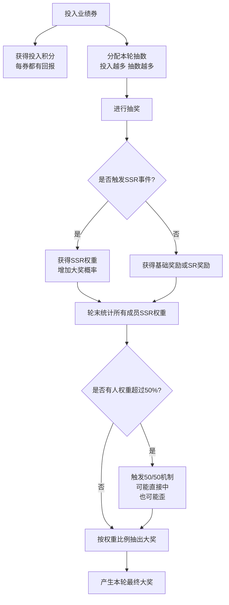

# 🎉 公司年度抽奖活动说明（共8轮）

感谢大家过去一年的努力和贡献！
今年的抽奖活动采用全新机制，共 **8轮抽奖**，每轮都有一个最终大奖。

---

# 🏆 最终大奖（SSR）

共8个：

* 1艘【万古级】
* 7艘【小旗舰】

每轮抽出1个大奖得主。

---

# 🎁 其他奖励

* SR舰船约50条（数量有限）
* 基础奖励与积分总价值约15B ISK

---

# 一、如何参与

每轮开始时，大家提交本轮想投入的“业绩券”数量。

### 每投入 1 张券：

* 立即获得 7M ISK 等值积分（一定有回报）
* 参与本轮大奖竞争

---

# 二、抽奖如何进行？

每轮最多进行 160 次抽奖。

如果大家总投入超过160：

* 系统会根据投入比例进行“合理分配”
* 投入多的人抽得更多
* 但不会出现一家通吃

---

# 三、单次抽奖规则

每次抽奖都有机会触发“SSR事件”。

* 抽到SSR或达到个人保底
* 会获得 1 点“SSR权重”

SSR权重代表你在最终大奖抽签中的“份额”。

没抽到SSR也一定会获得基础奖励或积分。

---

# 四、最终大奖怎么决定？

每轮结束后，根据大家获得的 SSR权重 抽出最终大奖。

### 情况1：如果权重差距不大

按比例抽出大奖得主。

---

### 情况2：如果某个人权重超过一半（50%）

触发“50/50机制”：

* 50%概率直接获得大奖
* 50%概率“歪掉”

如果歪掉：

* 该玩家获得补偿奖励
* 从名单中移除
* 剩余人员重新抽奖

若最后只剩1人，则直接获得大奖。

---

# 五、简单理解

* 投入越多，优势越大
* 但不会100%必胜
* 所有人都有机会逆袭
* 每张券都有基础回报
* 每轮一定会产生一个最终大奖得主

---

# 六、积分用途

积分可兑换：

* 常规舰船
* ISK奖励
* 物资奖励
* SR自选

详细兑换列表后续公布。

---
# 流程图

---

# 🎯 活动核心原则

✔ 公平
✔ 有竞争
✔ 有运气
✔ 有保障

希望大家玩得开心，也祝大家冲击万古级成功！ 🚀

---

# 📌 活动常见问题说明（Q&A）

---

### Q1：投入多，会不会抽得很少？

不会。
投入越多，分到的抽数一定越多，只是增长是“递减”的，不会出现极端碾压。

---

### Q2：投入少是不是几乎没机会？

不会。
投入少抽得少，但只要触发SSR事件就能获得权重。
最终大奖是“权重抽签”，并非完全看投入大小。

---

### Q3：抽到SSR是不是就直接拿大奖？

不是。
抽到SSR会获得“SSR权重”。
轮末根据所有人的权重抽出最终大奖得主。

可以理解为：

> 抽到SSR = 获得一张“大奖抽签票”。

---

### Q4：如果某个人权重超过50%，是不是稳赢？

不是。
当某个人权重超过50%时，会触发“50/50机制”：

* 50%直接获得大奖
* 50%会“歪”

所以即便权重很高，也不是必胜。

---

### Q5：歪掉会不会很亏？

不会。
歪掉的人会获得补偿奖励（SR自选或等值奖励）。
不会出现“什么都没有”的情况。

---

### Q6：会不会最后没人中奖？

不会。
规则保证每轮一定产生一名最终大奖得主。

---

### Q7：每轮独立吗？

是的。
每轮独立结算，不会继承权重。

---

### Q8：投入少还能后面补吗？

可以。
每轮独立，你可以根据情况选择投入策略。

---

### Q9：为什么设160抽上限？

为了保证：

* 每轮节奏稳定
* 不会因为极端投入导致系统失衡
* 保持公平性

---

### Q10：这个活动的核心理念是什么？

* 投入越多，优势越大
* 但没有人必胜
* 每个人都有机会
* 每张券都有回报

